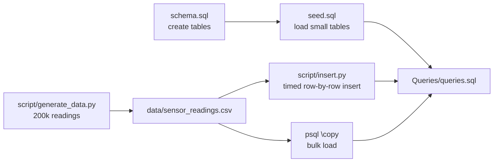

# SQL Practice: Building Sensor Monitoring Database

A PostgreSQL practice project built around a small monitoring system: buildings have cameras, cameras record temperature and humidity readings, and alerts are raised for users. It covers schema design, data loading at volume (200,000 generated readings), and SQL queries from basic filtering to window functions.


## Problem Statement

Learning SQL on toy tables with five rows hides the questions that matter in practice: how to model related entities with foreign keys, how to load data in the right order, and how long it takes to insert a large volume of rows. This project uses a realistic schema and a generated time series so those questions come up naturally.

## Objectives

- Design a normalised relational schema with primary and foreign keys.
- Generate a large synthetic dataset and load it into PostgreSQL.
- Measure the cost of row-by-row inserts from Python.
- Practise SQL: filtering, sorting, aggregation, joins, CTEs and window functions.

## Technologies

| Area | Tools |
|---|---|
| Database | PostgreSQL |
| Data generation and loading | Python, `csv`, `psycopg` 3 |
| Client | `psql` |

## Database Schema


| Table | Purpose |
|---|---|
| `buildings` | Monitored sites (name, city) |
| `cameras` | Devices installed in a building |
| `sensor_readings` | Temperature and humidity readings per camera, one per minute |
| `users` | People who receive alerts |
| `alerts` | Alert messages raised by a camera, optionally assigned to a user |

## Workflow



## Project Structure

```text
sql-practice/
├── schema.sql                 # table definitions
├── seed.sql                   # loads data/*.csv (except sensor readings)
├── ERD.png                    # schema diagram
├── data/                      # CSV data (sensor_readings.csv is generated)
├── script/
│   ├── generate_data.py       # writes 200,000 synthetic readings
│   └── insert.py              # inserts readings row by row and prints the time taken
├── Queries/
│   ├── queries.sql            # practice questions on the sensor database
│   └── solutions_cas1.sql     # solutions to the "Danny's Diner" case study
├── requirements.txt
└── .env.example
```

## Installation

Requirements: PostgreSQL (with `psql`) and Python 3.12+.

```bash
git clone https://github.com/Re7absu/sql-practice.git
cd sql-practice
python -m venv .venv
source .venv/bin/activate        # Windows: .venv\Scripts\activate
pip install -r requirements.txt
```

## How to Run

All commands are run from the repository root.

1. Create the database, the tables and the reference data:

   ```bash
   createdb sensors
   psql -d sensors -f schema.sql
   psql -d sensors -f seed.sql
   ```

2. Load the sensor readings, using **one** of these options:

   ```bash
   # Option A: row-by-row insert from Python (prints the time taken)
   cp .env.example .env              # then set your own connection values
   export $(grep -v '^#' .env | xargs)   # or set PGHOST, PGUSER, PGPASSWORD... in your shell
   python script/insert.py

   # Option B: bulk load with psql
   psql -d sensors -c "\copy sensor_readings (camera_id, temperature, humidity, recorded_at) FROM 'data/sensor_readings.csv' WITH (FORMAT csv)"
   ```

   To create a fresh set of readings first, run `python script/generate_data.py`.

3. Run the practice queries:

   ```bash
   psql -d sensors -f Queries/queries.sql
   ```

## Features

- Five related tables with foreign-key constraints.
- A data generator for 200,000 minute-by-minute readings across 20 cameras.
- A timed Python loader for comparing row-by-row inserts with bulk loading.
- Practice queries on alerts and readings (filtering, ordering, `GROUP BY`).
- Solutions to all ten questions of the [Danny's Diner case study](https://8weeksqlchallenge.com/case-study-1/) from the *8 Week SQL Challenge*, using joins, CTEs, `CASE` and `ROW_NUMBER()`/`RANK()` window functions. The case-study tables are not included here; they come from the challenge page.

## Future Improvements

- Compare insert strategies side by side (`executemany`, `COPY`, batch size) and record the timings.
- Add indexes on `sensor_readings (camera_id, recorded_at)` and compare query plans with `EXPLAIN ANALYZE`.
- Finish the open questions in `queries.sql` (average temperature and humidity).
- Add time-series queries: hourly averages, rolling windows and threshold-based alert detection.
